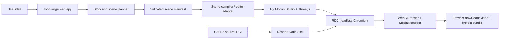
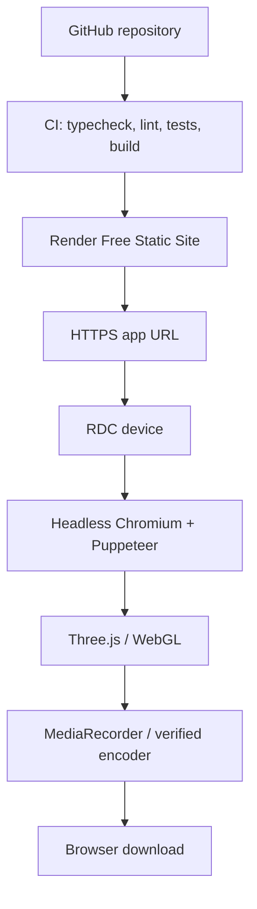

# ToonForge AI — System Architecture

**Document:** Solution Architecture / Technical Design  
**Version:** 1.0  
**Date:** 18 November 2026  
**Status:** Proposed; feasibility gates remain open  
**Project folder:** `/ToonForge AI`

## 1. Executive decision

ToonForge AI will be a browser-first prompt-to-cartoon production system. My Motion Studio (`rodolphe37/my-motion-studio`, MIT) is the candidate 3D editor foundation. The app is intended to be hosted as a Render Free Static Site; RDC headless Chromium will open and automate the app; Three.js/WebGL rendering and browser media capture will run on the RDC client, not on Render.

This is a staged architecture, not a claim that prompt-to-video already exists. Basic RDC Chromium automation has been verified against a test website. The target editor, WebGL acceleration, media export, and 1–3 minute performance have **not** yet been verified.

## 2. Product objective

Input: a user idea, target duration, tone and visual constraints.  
Output: an editable story/scene plan and an original, family-friendly stylized 3D cartoon video of 1–3 minutes.

“Pixar-like” is interpreted only as broad visual qualities (appealing stylized characters, expressive animation, polished materials and cinematic lighting). Do not copy protected characters, designs, or studio-specific assets.

Initial output format is **WebM if confirmed by the actual browser recorder**. MP4 is not promised until a real encoding/conversion path is implemented and tested.

## 3. Goals and non-goals

### Goals
- Automate idea → story → scenes → assets → animation → preview → export.
- Reuse the existing editor where its actual code supports the workflow.
- Keep prototype infrastructure at $0.
- Keep rendering in the browser/client.
- Use versioned, validated data contracts and repeatable tests.
- Make projects exportable and portable.

### Non-goals for v1
- Cloud render farm or Blender rendering on Render Free.
- Guaranteed studio-grade animation.
- Arbitrary automatic text-to-rigged-character generation.
- Guaranteed MP4/MOV export.
- Public publishing or automatic upload to third-party platforms.
- Paid APIs or infrastructure without explicit approval.

## 4. Constraints and known baseline

| Area | Evidence / constraint | Implication |
|---|---|---|
| My Motion Studio | React 19, TypeScript, Vite, Three.js, React Three Fiber, Zustand; MIT | Candidate editor, not a complete AI video generator |
| Existing editor | 3D canvas, object/transform controls and keyframe-oriented functionality inspected | Reuse after source audit and integration tests |
| Existing export | Browser capture / MediaRecorder path observed in source | Test real supported MIME types; UI labels alone prove nothing |
| RDC | Headless Chromium + Puppeteer navigated to example.com and inspected DOM successfully | Basic browser automation proven |
| RDC graphics | WebGL/WebGL2 and editor compatibility not yet tested | Rendering feasibility open |
| RDC host | Headless ARM64 Linux; limited RAM; no dedicated GPU detected in prior inspection | Do not assume fast hardware-accelerated rendering |
| Render Free | Suitable for static frontend hosting; not long-running GPU rendering | Host app only; do not render videos on Render |
| Budget | $0 prototype target | Avoid paid model APIs, GPU services and paid storage |

Machine specifications should be rechecked before performance decisions.

## 5. System context



Render serves frontend files. It does not render the 3D scenes. The browser/device performs graphics rendering and recording.

## 6. Building blocks

### 6.1 Web application
**Stack:** React, TypeScript, Vite, Three.js, React Three Fiber and Zustand, reusing My Motion Studio where appropriate.

Responsibilities: project setup, prompt input, scene plan review, asset selection, timeline, preview, export and project import/export.

### 6.2 Story and scene planner
Transforms the prompt into:
- synopsis and character descriptions;
- scene list and duration budget;
- dialogue/narration;
- shot and camera instructions;
- asset requirements;
- animation cues and transitions.

The planner returns structured data matching a versioned schema. Invalid output is rejected. Model-generated text must never be executed as code.

**Cost reality:** no free LLM provider or local inference capability is assumed. Keep the planner provider-independent; first support manual/sample manifests. Evaluate local or hosted models only after verifying quality, hardware, terms and actual cost.

### 6.3 Asset pipeline
Initial assets should be original, procedural, or properly licensed GLB/glTF files. Track each asset's source and license. Validate file type, size, loadability and references. Automatic text-to-rigged-character creation is out of scope until a viable open-source workflow is proven.

### 6.4 Scene manifest and compiler
A typed scene manifest separates planning from editor-specific state. A compiler/adapter maps it into the real editor model: load scene, add assets, set transforms/materials, configure camera/lights, create animation cues and align dialogue.

The schema below is illustrative; it is **not** asserted to be accepted by upstream My Motion Studio without an adapter.

```json
{
  "schemaVersion": "1.0",
  "project": {
    "title": "A Small Adventure",
    "targetDurationSeconds": 90,
    "frameRate": 24,
    "resolution": { "width": 1280, "height": 720 }
  },
  "assets": [
    { "id": "hero", "type": "character", "uri": "assets/hero.glb", "license": "recorded-license" }
  ],
  "scenes": [
    {
      "id": "scene-01",
      "durationSeconds": 20,
      "objects": [
        { "assetId": "hero", "position": [0, 0, 0], "rotation": [0, 0, 0], "scale": [1, 1, 1] }
      ],
      "camera": { "shot": "wide" },
      "animationCues": [],
      "dialogue": []
    }
  ]
}
```

### 6.5 Renderer and exporter
Run rendering in Chromium on the client. Test the actual `MediaRecorder` MIME types with `MediaRecorder.isTypeSupported()`. Record a short scene, then validate file size, playability, duration and dimensions. If Chromium only produces WebM, WebM is the v1 format. MP4 requires a verified browser-side encoder or a separately approved conversion environment.

### 6.6 Storage
For the prototype, keep the deployed app static, keep working project state in browser storage where appropriate, and download final video/project bundles directly to the user's device. Do not rely on Render Free service filesystem for persistent projects or video files.

## 7. Runtime workflow

1. User enters idea and target duration.
2. Planner creates story outline and scene manifest.
3. Schema validation checks timing, references and required fields.
4. Asset resolver verifies all assets exist and load.
5. Scene compiler translates the manifest into editor state.
6. Browser loads each scene and runs preview checks.
7. Preview is reviewed/approved.
8. Browser records the scene sequence.
9. Export validator checks the media file.
10. User downloads video and project bundle.

Each stage must have explicit status, bounded retries and recoverable errors. A failed scene should be retryable without rebuilding the whole project.

## 8. Deployment architecture



- **GitHub:** source control and CI.
- **Render Free Static Site:** serves built frontend files.
- **RDC:** remote command and browser automation.
- **Chromium:** app runtime, WebGL and media capture.
- **Client download:** final video and project bundle.

No repository, Render service or deployment has been created by this architecture document. Those external changes require separate approval.

## 9. Browser automation contract

Implement small, idempotent operations such as:
`open_project`, `load_manifest`, `load_asset`, `apply_scene`, `preview_scene`, `render_scene`, `export_video`, `validate_export`.

Each operation must check preconditions, wait for a meaningful application state, return structured results, capture useful diagnostics on failure, and define whether retry is safe. Prefer stable application APIs and DOM selectors over coordinate-only clicking. RDC is headless; do not assume a visible desktop is available.

## 10. Security and reliability

- Treat prompts, model output, imported projects and assets as untrusted.
- Validate planner output against strict schemas.
- Never execute generated shell commands or JavaScript.
- Enforce asset format and size limits; record licensing/provenance.
- Keep secrets out of frontend bundles and browser storage.
- Do not send private project data to an external model without an explicit provider choice.
- Use timeouts, bounded retries, stage-level logs and project checkpoints.
- Do not auto-publish or externally upload generated media.

## 11. Acceptance criteria

| Area | Required proof |
|---|---|
| App runtime | Target editor loads in RDC Chromium without fatal errors |
| WebGL | WebGL/WebGL2 initialization succeeds; renderer type is recorded |
| Scene compiler | Known manifest creates expected objects, transforms and timeline |
| Repeatability | Same manifest produces same scene structure |
| Export | Short test produces a playable file with expected duration/dimensions |
| Performance | 1–3 minute target benchmark completes without crash or unacceptable memory pressure |
| Recovery | A failed scene can be retried without corrupting project |
| Portability | Manifest and assets export/import successfully |
| Cost | No paid service required for prototype |
| Safety | No automatic public posting or external upload |

## 12. Mandatory feasibility gates

**Gate A — app:** run the unmodified My Motion Studio build; verify app readiness, console errors and network failures.

**Gate B — graphics:** test WebGL and WebGL2; record renderer details where exposed; distinguish hardware acceleration from software fallback; render an animated Three.js test scene.

**Gate C — recording:** inspect supported MediaRecorder MIME types; record 10 seconds; verify downloaded file and actual format. Do not infer MP4 support from a UI dropdown.

**Gate D — performance:** benchmark a representative 720p/24fps scene at 10 seconds, then 30 seconds, then 1 minute. Measure elapsed time, peak memory, dropped frames and browser stability before attempting 1–3 minutes.

**Gate E — automation:** run a known manifest through scene creation, preview and export, including one controlled failure/retry test.

**Stop condition:** if WebGL or export is too slow/unstable on RDC, keep Render as static hosting but use a suitable user-controlled rendering client. Do not move Blender rendering onto Render Free to compensate for client limitations.

## 13. Phased roadmap

| Phase | Work | Exit condition |
|---|---|---|
| 0. Feasibility | Source audit, app load, WebGL, recorder and performance tests | Target browser can reliably render and export short scenes |
| 1. Foundation | Approved repo/fork, pinned dependencies, CI, approved static deployment | Reproducible build and stable HTTPS app |
| 2. Scene contract | Versioned schema, validator, import/export, editor adapter | Manifest deterministically creates a scene |
| 3. Planning | Provider-independent planner and structured output validation | Prompt yields editable valid scene plan |
| 4. Assets/animation | Asset catalogue, animation presets, camera templates, transitions/audio timing | Multiple scenes assembled automatically |
| 5. Rendering | Preview, recording, export validation and retry | Repeatable 1–3 minute export within measured hardware envelope |
| 6. Release | E2E regression, security/licensing review, recovery and release checklist | All acceptance criteria pass |

## 14. Architecture decisions

| ID | Decision | Status |
|---|---|---|
| ADR-001 | Browser-first rendering; Render hosts only | Proposed |
| ADR-002 | My Motion Studio is the initial editor foundation, subject to validation | Proposed |
| ADR-003 | RDC headless Chromium is the automation client | Proposed; basic browser test passed, WebGL unverified |
| ADR-004 | Versioned scene manifest separates planning from editor execution | Proposed |
| ADR-005 | WebM is provisional output until another format is proven | Proposed |
| ADR-006 | No paid services/infrastructure without explicit approval | Project constraint |
| ADR-007 | No automatic public publishing or external upload | Project constraint |

## 15. Risks and open questions

| Risk / question | Mitigation or next action |
|---|---|
| RDC WebGL may be software-rendered | Identify renderer and benchmark before feature build |
| ARM CPU/RAM may limit long exports | Measure memory/time; use lower settings or another client if needed |
| Export UI may advertise unsupported formats | Test MIME support and actual file playback |
| Editor may not expose a stable programmatic scene API | Audit source; implement typed adapter |
| No-cost LLM may be impractical on this device | Keep manual manifest path and provider abstraction |
| Asset licenses may be unclear | Maintain provenance/license manifest |
| Render Free is not persistent render compute | Static hosting only; browser downloads final media |

Open questions:
1. Does the RDC Chromium build expose WebGL2, and is it hardware accelerated?
2. Does My Motion Studio load and remain stable in that browser?
3. Which MediaRecorder formats are actually supported?
4. Can headless Chromium export without user-gesture or visibility restrictions?
5. What are measured time and peak memory for 10s/30s/60s scenes?
6. Which no-cost planning model is practical and reliable?
7. Which GitHub repository/account should own the project? No repo has been created.

## 16. Current status and next task

**Verified:** My Motion Studio repository metadata and selected core files were inspected; RDC headless Chromium successfully navigated to a test website and inspected its DOM.

**Not yet verified/done:** complete source audit, target app in RDC, WebGL renderer, actual video export, 1–3 minute performance, repository creation, Render deployment, and prompt-to-video implementation.

**Next task:** run the read-only RDC feasibility suite against My Motion Studio: app load, WebGL/WebGL2 and renderer identification, MediaRecorder MIME support, and a short test render/export. Review results before requesting approval for repository creation or deployment.

## Appendix — proposed repository layout

```text
toonforge-ai/
├── apps/web/
├── packages/
│   ├── scene-schema/
│   ├── planner/
│   ├── scene-compiler/
│   ├── asset-catalog/
│   └── browser-automation/
├── assets/{characters,environments,props,audio}/
├── examples/sample-projects/
├── tests/{schema,scene-compiler,e2e}/
├── docs/ARCHITECTURE.md
└── README.md
```

This is a target structure, not the current upstream layout. Adopt incrementally after source audit; do not recreate or reorganize the upstream project blindly.